# Filament Sidekick

[](https://packagist.org/packages/devletes/filament-sidekick)
[](https://packagist.org/packages/devletes/filament-sidekick)
[](https://packagist.org/packages/devletes/filament-sidekick)
[](https://github.com/devletes/filament-sidekick/stargazers)

An AI assistant panel for Filament 5 **that cannot write to your database on its own.** The model may only *propose* a change; it arrives as a confirmation card, and the write runs on the user's Confirm click, under their session.

- **Reads and writes are different classes.** A `ChatTool` answers; a `SidekickAction` proposes. There is no code path from the model to `execute()`
- **Unauthorized tools are never offered**, so a tool the user cannot use is not in the prompt to be talked into
- **Multi-tenant by construction** — panel, tenant and guard are restored in the queue worker; a turn that cannot restore its tenant refuses to run
- **Attachment contents never reach the model** — only name, type and size
- **A panel that pushes the page aside** instead of covering it, with turns that survive navigation, usage limits, an insights page and a `--sidekick-*` theming surface

<table><tr>
<td width="50%">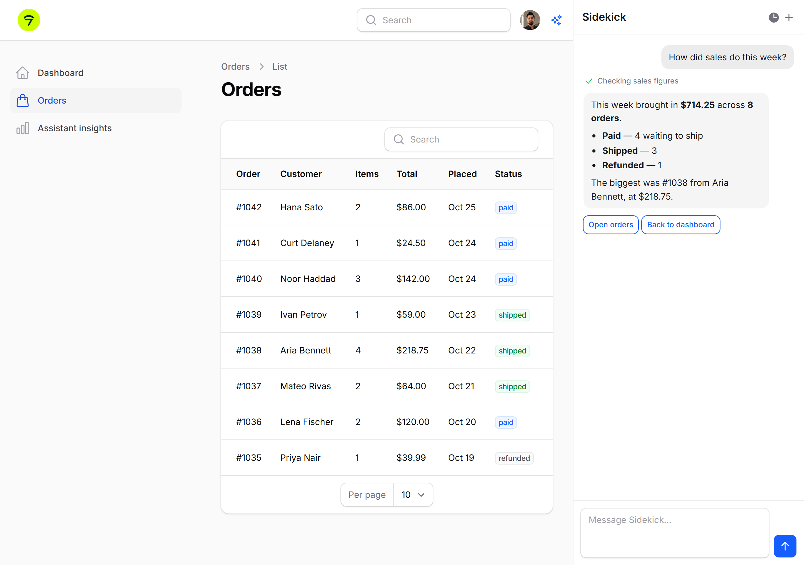</td>
<td width="50%">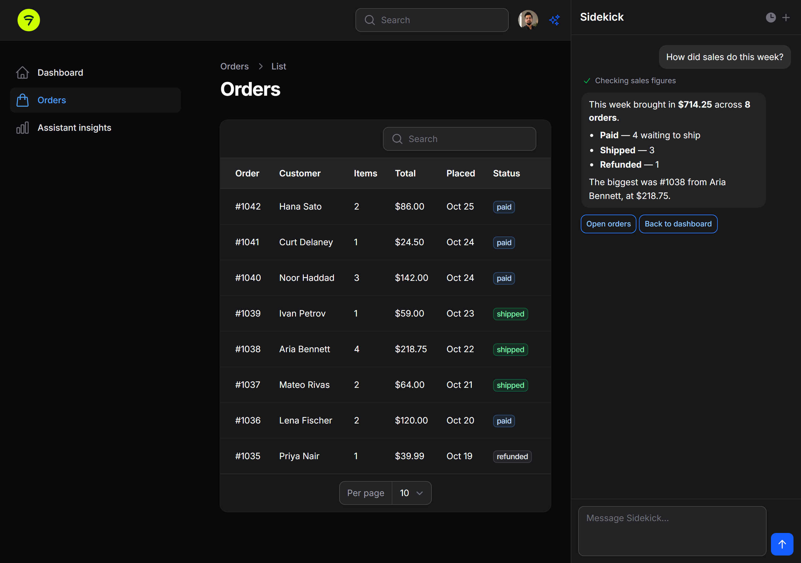</td>
</tr></table>

## Requirements

- PHP `^8.3`
- Filament `^5.0` on Laravel 12 or 13
- `laravel/ai` `^1.0`, with a configured provider
- A queue worker — turns are queued jobs

## Installation

```bash
composer require devletes/filament-sidekick
```

```bash
php artisan sidekick:install
```

The installer publishes the config and offers to run the migrations (`--migrate` runs them without asking). Then register the plugin on your panel:

```php
use Devletes\Sidekick\SidekickPlugin;

return $panel->plugins([
    SidekickPlugin::make(),
]);
```

Set a `laravel/ai` provider key in `.env` and run `php artisan queue:work`. That's a working assistant — it just has no tools yet.

> A turn's job timeout is `sidekick.timeout` + 60s. Your queue connection's `retry_after` must be larger, or a slow turn gets redelivered mid-stream.

### Upgrading from laravel/ai 0.x

laravel/ai 1.0 stores conversation messages as `steps` instead of `tool_calls` / `tool_results`. Sidekick ships a migration that rewrites existing rows and drops the old columns, so `php artisan migrate` is the whole upgrade — **do not also add laravel/ai's own upgrade migration**. If you already ran that one, Sidekick's does nothing. The rewrite is one-way, so back up the conversation tables first.

## Quick start

Generate a read tool:

```bash
php artisan sidekick:tool SalesSummary
```

Classes under `app/Sidekick` are discovered automatically — there is no registration step. Fill in `handle()`, scope it to `$this->user`, and ask the assistant about it:

<table><tr>
<td width="50%">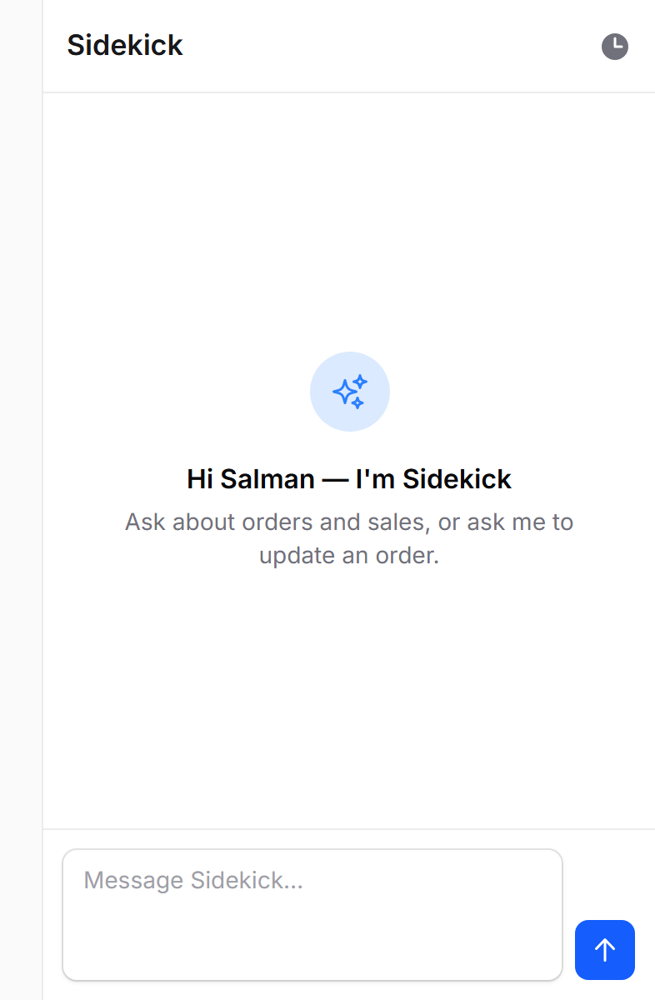</td>
<td width="50%">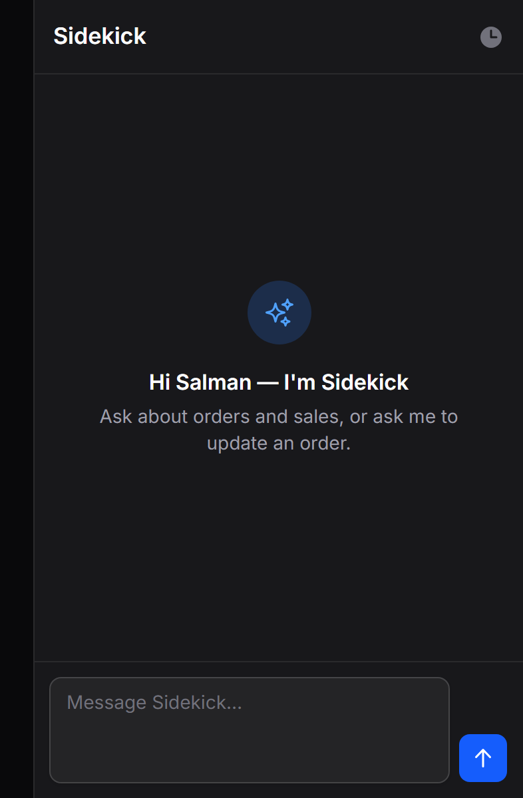</td>
</tr></table>

Then generate a write with `php artisan sidekick:action CancelOrder`, or let `php artisan sidekick:scaffold` draft one tool per Filament resource.

## Naming your assistant

"Sidekick" is the package; the assistant your users talk to can be called anything. The name heads the panel, labels the toggle, greets people in an empty chat ("Hi Salman — I'm Atlas"), and opens the system prompt ("You are Atlas, an in-app assistant"):

```php
// config/sidekick.php
'assistant' => [
    'name' => 'Atlas',
    'description' => 'Ask about orders and sales, or ask me to update an order.',
],

// Appended to the system prompt: tone, house rules, what the product is.
'instructions' => 'You work inside Acme Commerce. Prices are in USD. Never promise delivery dates.',
```

Pair it with your own toggle icon, and give each panel its own assistant with [profiles](#profiles):

```php
SidekickPlugin::make()->icon(view('icons.atlas'))
```

## Tools

A tool answers questions. It runs during the turn, with the chatting user as `$this->user`:

```php
namespace App\Sidekick\Tools;

use App\Models\Order;
use Devletes\Sidekick\Support\ChatToolBase;
use Illuminate\Contracts\JsonSchema\JsonSchema;
use Laravel\Ai\Tools\Request;

class SalesSummary extends ChatToolBase
{
    public function description(): string
    {
        return 'Revenue, order count and orders by status for a date range.';
    }

    public function schema(JsonSchema $schema): array
    {
        return [
            'from' => $schema->string()->description('YYYY-MM-DD')->required(),
            'to' => $schema->string()->description('YYYY-MM-DD')->required(),
        ];
    }

    public function label(): string
    {
        return 'Checking sales figures';
    }

    public function handle(Request $request): string
    {
        // $this->user is the chatting user — scope every query to what they may see.
        $orders = Order::query()
            ->visibleTo($this->user)
            ->whereBetween('placed_at', [$request['from'], $request['to']])
            ->get();

        return $this->respond([
            'revenue' => $orders->sum('total'),
            'orders' => $orders->count(),
            'by_status' => $orders->countBy('status'),
        ]);
    }
}
```

The panel shows each tool's `label()` while it runs, then renders the reply as markdown.

<table><tr>
<td width="50%">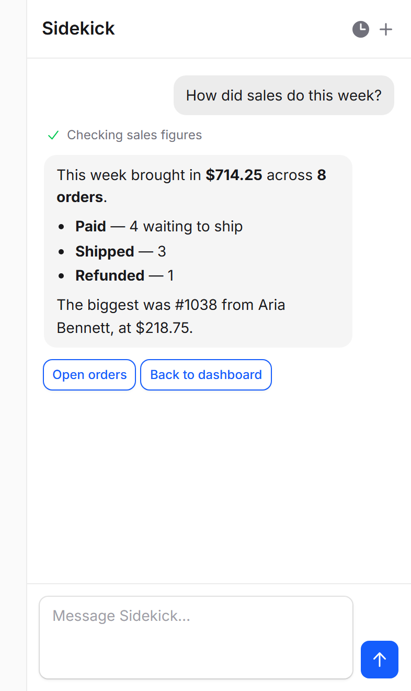</td>
<td width="50%">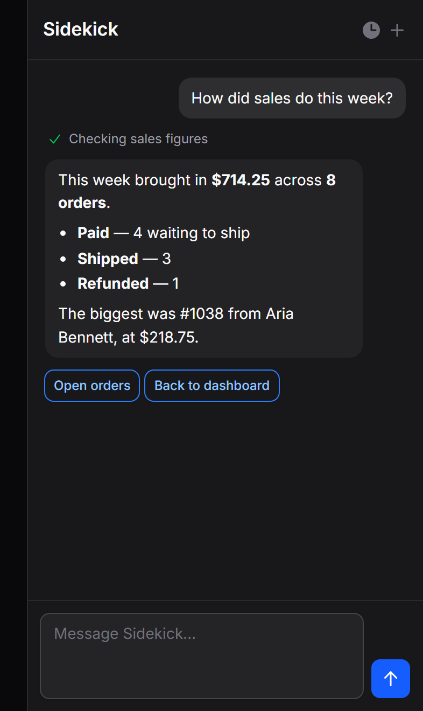</td>
</tr></table>

| Method | Notes |
|---|---|
| `authorize($user)` | Unauthorized users are never offered the tool. Defaults to everyone |
| `label()` | Status line in the panel. Defaults to the class name |
| `instructions()` | System-prompt guidance added while this tool is offered. Hard-coded text only — never interpolate user or record data |
| `panels()` | Panel ids that offer this tool. Defaults to `['*']` |
| `dependsOn()` | Classes this tool cannot work without. Delete one and the tool is withheld instead of fataling |

```php
use Illuminate\Contracts\Auth\Authenticatable;

public function authorize(Authenticatable $user): bool
{
    return $user->can('viewAny', Order::class);
}

public function instructions(): ?string
{
    return 'Quote revenue from SalesSummary rather than adding up orders yourself.';
}

public function panels(): array
{
    return ['admin'];
}
```

### Per-turn context

A tool with something to say that changes from turn to turn — where a checklist stands, what the user is looking at — implements `Contracts\ProvidesTurnContext`. Its `turnContext()` rides on the user's message rather than the system prompt, so the instructions stay identical between turns and stay cached:

```php
use Devletes\Sidekick\Contracts\ProvidesTurnContext;
use Devletes\Sidekick\Support\ChatToolBase;

class StoreSetup extends ChatToolBase implements ProvidesTurnContext
{
    // description(), schema(), handle() as usual…

    public function turnContext(): ?string
    {
        $step = SetupChecklist::for($this->user)->current();

        return $step ? "Store setup: step {$step->number} of 9 — {$step->title}." : null;
    }
}
```

## Actions

Writes never run from the model. An action is one class extending `Support\SidekickAction`, offered to the model as a `Propose{ClassName}` tool. `prepare()` validates the payload into a confirmation card; `execute()` runs only on the user's Confirm click.

```php
namespace App\Sidekick\Actions;

use App\Models\Order;
use Devletes\Sidekick\Support\SidekickAction;
use Illuminate\Contracts\Auth\Authenticatable;
use Illuminate\Contracts\JsonSchema\JsonSchema;
use InvalidArgumentException;

class CancelOrder extends SidekickAction
{
    public function description(): string
    {
        return 'Cancel an order that has not shipped yet and refund it in full.';
    }

    public function schema(JsonSchema $schema): array
    {
        return [
            'number' => $schema->integer()->description('The order number, without the #.')->required(),
        ];
    }

    public function prepare(array $payload, Authenticatable $user): array
    {
        $order = Order::query()->visibleTo($user)->where('number', $payload['number'])->first();

        // Thrown messages go back to the model, so it can correct itself.
        if ($order?->status !== 'paid') {
            throw new InvalidArgumentException('No unshipped order has that number.');
        }

        return [
            'payload' => ['number' => $order->number],
            'summary' => "Cancel order #{$order->number}",
            'preview' => [
                ['label' => 'Customer', 'value' => $order->customer],
                ['label' => 'Items', 'value' => (string) $order->items],
                ['label' => 'Refund', 'value' => '$'.number_format($order->total, 2).' in full'],
            ],
        ];
    }

    public function execute(array $payload, Authenticatable $user): string
    {
        Order::query()->visibleTo($user)->where('number', $payload['number'])->firstOrFail()->cancel();

        return 'Cancelled and refunded in full.';
    }
}
```

The card replaces the composer until answered. Confirming is claimed atomically, so a second tab cannot execute the same action twice.

<table><tr>
<td width="50%">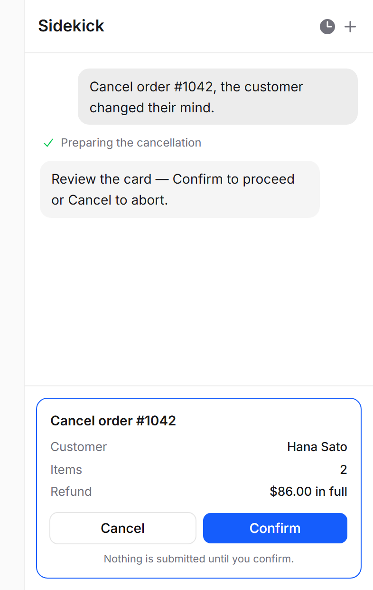</td>
<td width="50%">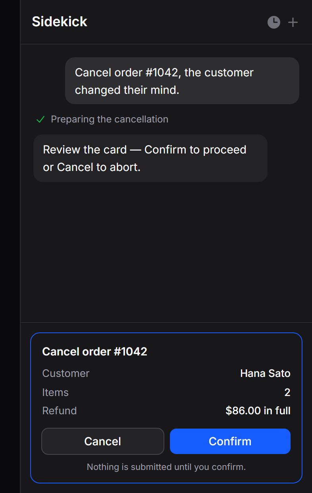</td>
</tr></table>

Answered cards leave a system-verified outcome in the timeline. That outcome is the only thing the model is told about what happened, so it can never claim success on its own.

<table><tr>
<td width="50%">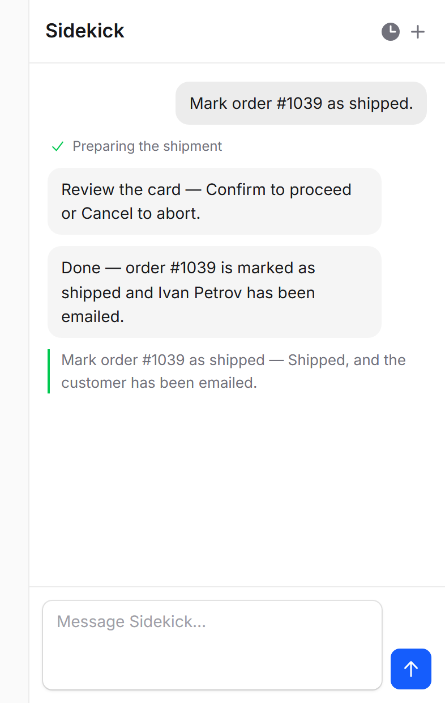</td>
<td width="50%">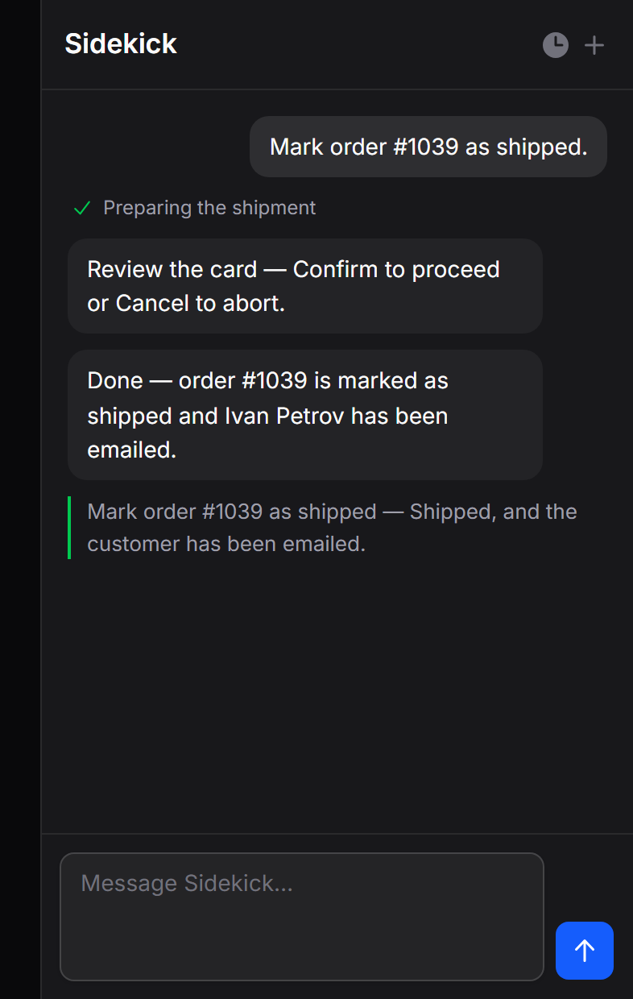</td>
</tr></table>

Actions take the same `authorize()`, `label()`, `instructions()`, `panels()` and `dependsOn()` as tools, plus `type()`, the key pending cards are stored under. It defaults to the snake_cased class name, so pin it before renaming a class that may have cards waiting:

```php
public function type(): string
{
    return 'cancel_order';
}
```

An action whose dependencies are missing stops being proposable *and* confirmable.

### Inline or modal

Confirmations render inline by default. When a preview is too tall or wide for the panel, open it in a modal instead:

```php
use Devletes\Sidekick\Enums\ConfirmationMode;

public function confirmation(): ConfirmationMode
{
    return ConfirmationMode::Modal;
}
```

<table><tr>
<td width="50%">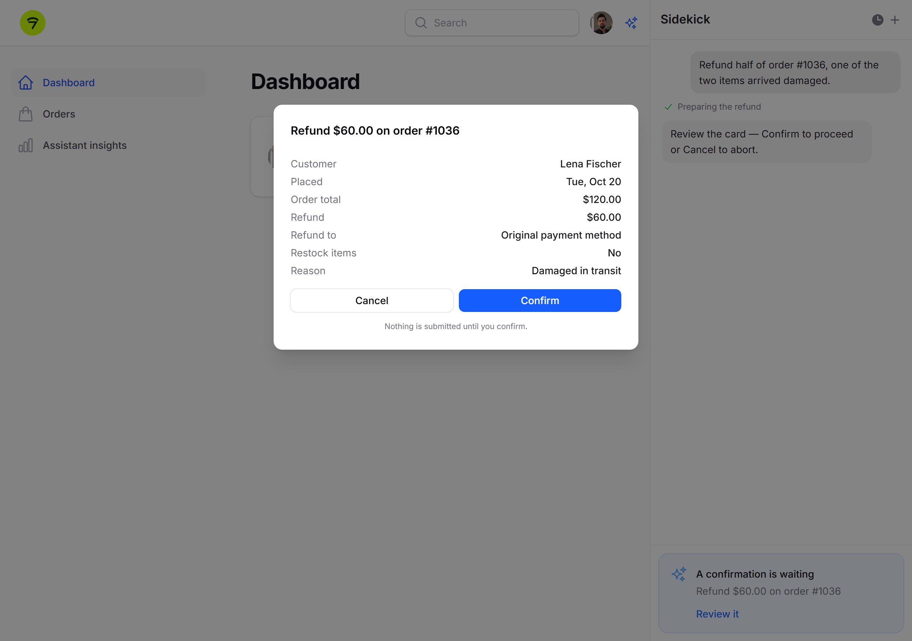</td>
<td width="50%">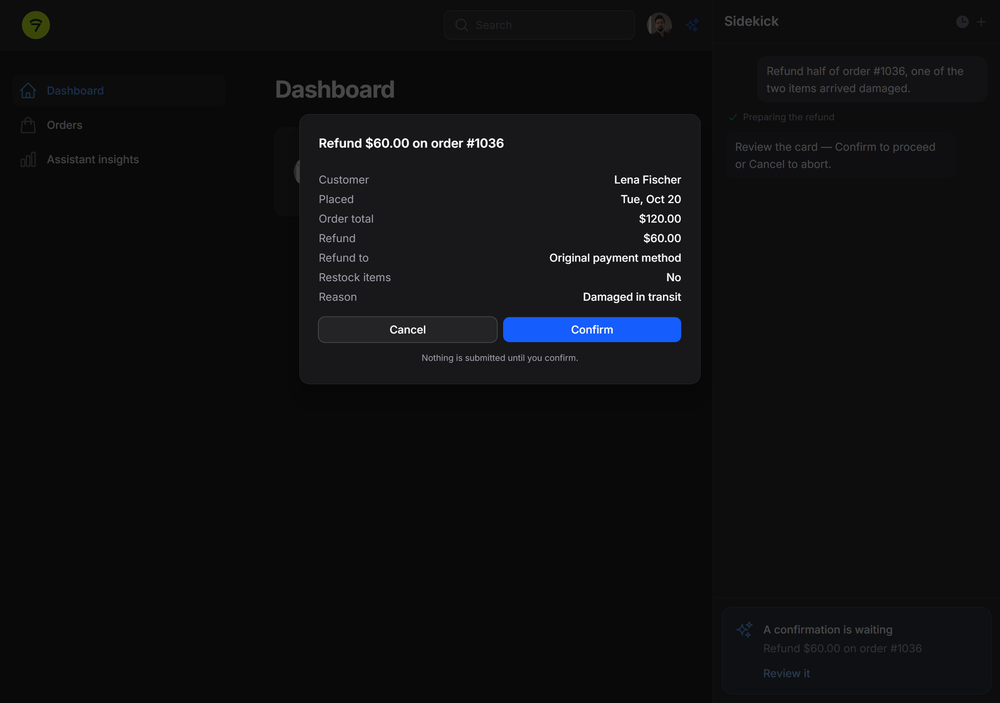</td>
</tr></table>

The modal can't be clicked or escaped away — answering it is the only way out. A page reload still escapes it, so the panel keeps a link back in until the card is answered, and modals never spring open on page load.

<table><tr>
<td width="50%">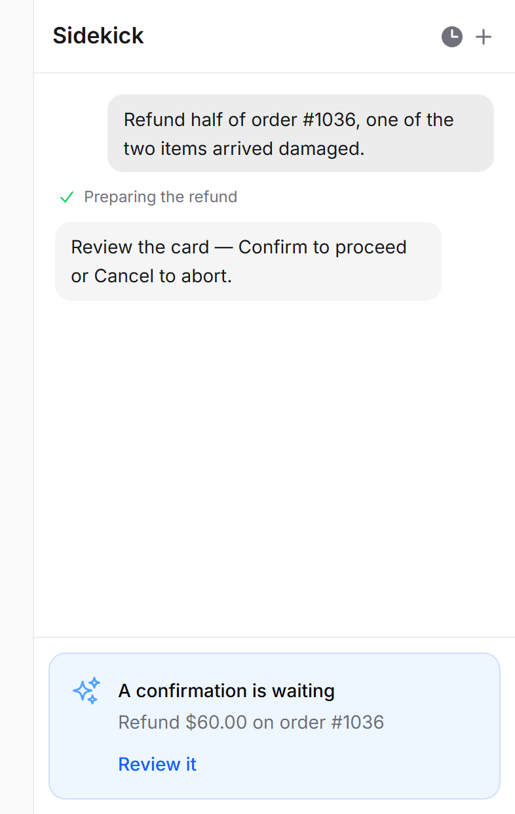</td>
<td width="50%">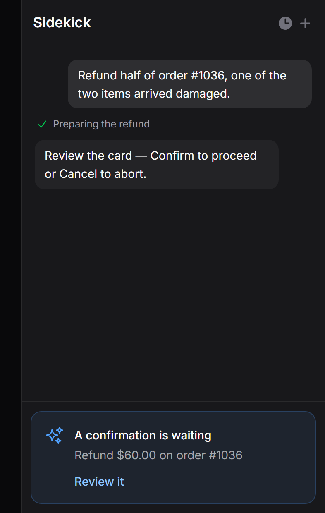</td>
</tr></table>

## Registering tools and actions

Three composable sources, deduplicated:

1. **Discovery** *(default)* — any class anywhere under `app/Sidekick`, scanned recursively and matched by contract, so group by kind, by domain, or not at all.
2. **Config** — class arrays in `sidekick.tools` / `sidekick.actions`, for classes living elsewhere.
3. **Runtime** — the `Sidekick` facade, for packages contributing tools.

```text
app/Sidekick/
├── Orders/
│   ├── SalesSummary.php       # ChatTool
│   └── CancelOrder.php        # SidekickAction
├── Catalog/
│   └── StockLevels.php
└── ResourceResolver.php       # neither — ignored
```

```php
// config/sidekick.php
'discover' => [
    'enabled' => true,
    'paths' => [app_path('Sidekick'), base_path('modules/Billing/Sidekick')],
],

'tools' => [\App\Support\Assistant\ExchangeRates::class],
'actions' => [],
```

Point discovery roots at trees that hold only Sidekick classes, since it autoloads what it finds. From a package's service provider:

```php
use Devletes\Sidekick\Facades\Sidekick;

public function boot(): void
{
    Sidekick::tools([InvoiceLookup::class])->actions([VoidInvoice::class]);
}
```

### Knowing what breaks

A tool outlives the resource it queries. `dependsOn()` names what a class cannot work without, and deleting one withholds the tool instead of fataling mid-turn:

```php
public function dependsOn(): array
{
    return [OrderResource::class, Order::class];
}
```

`php artisan sidekick:check` reports every tool and action with a missing dependency and exits non-zero, so CI catches it. It reads declared `dependsOn()` entries *and* each file's imports. Before deleting something, ask what depends on it:

```bash
php artisan sidekick:check --uses="App\Filament\Resources\OrderResource"
```

## Navigation

`Navigate` (redirect when the reply finishes) and `PresentActions` (buttons under a reply, like **Open orders** above) ship with the package. Both wake once you bind an `ActionResolver`, which maps named targets to authorized URLs:

```php
namespace App\Sidekick;

use App\Filament\Resources\OrderResource;
use App\Models\Order;
use Devletes\Sidekick\Contracts\ActionResolver;
use Illuminate\Contracts\Auth\Authenticatable;

class ResourceResolver implements ActionResolver
{
    public function targets(): array
    {
        return ['orders', 'order'];
    }

    // Return null for anything unknown or not allowed — never throw.
    public function resolve(string $target, ?string $record, Authenticatable $user): ?string
    {
        return match ($target) {
            'orders' => OrderResource::getUrl('index'),
            'order' => ($order = Order::find($record)) && $user->can('view', $order)
                ? OrderResource::getUrl('view', ['record' => $order])
                : null,
            default => null,
        };
    }
}
```

```php
// config/sidekick.php
'action_resolver' => \App\Sidekick\ResourceResolver::class,

// Keep either built-in off even with a resolver bound.
'builtin_tools' => [
    'navigate' => true,
    'present_actions' => true,
],
```

Model-authored button URLs are restricted to `http(s)`.

## Scaffolding

```bash
php artisan sidekick:scaffold --dry-run    # preview
php artisan sidekick:scaffold --actions    # tools, resolver, and Create{Model} action stubs
```

Generates a `Search{Models}` tool per Filament resource plus one `ResourceResolver` (tenant-aware when the panel has tenancy). Action stubs throw until you implement `execute()`. Every file carries TODOs, notably `authorize()`, and re-runs never overwrite. Narrow it in config:

```php
// config/sidekick.php
'scaffold' => [
    'only' => [\App\Filament\Resources\OrderResource::class],
    'ignore' => [\App\Filament\Resources\UserResource::class],
],
```

## Streaming

The panel shows each tool as it is called and reveals the reply as it streams. Progress lives on the run row, not in component state, so a turn survives full page navigations.

<table><tr>
<td width="50%">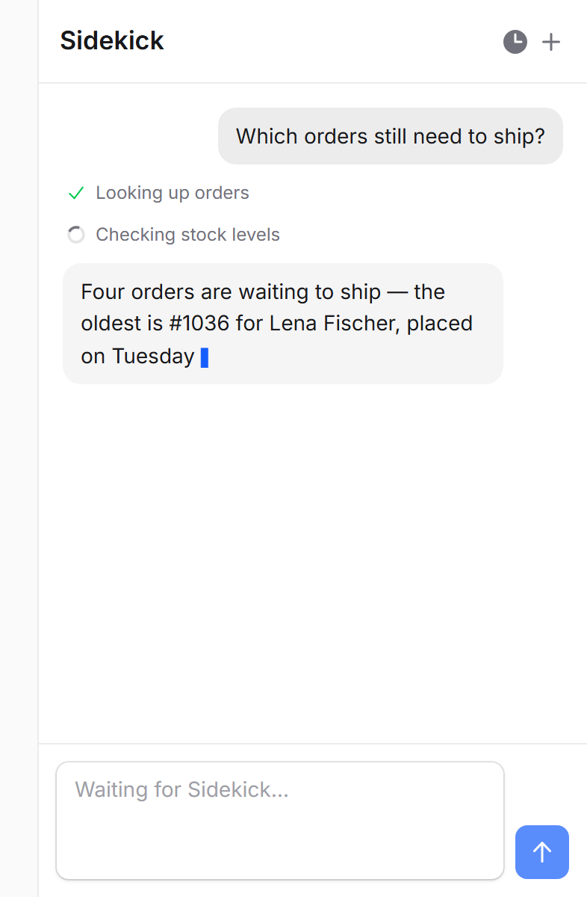</td>
<td width="50%">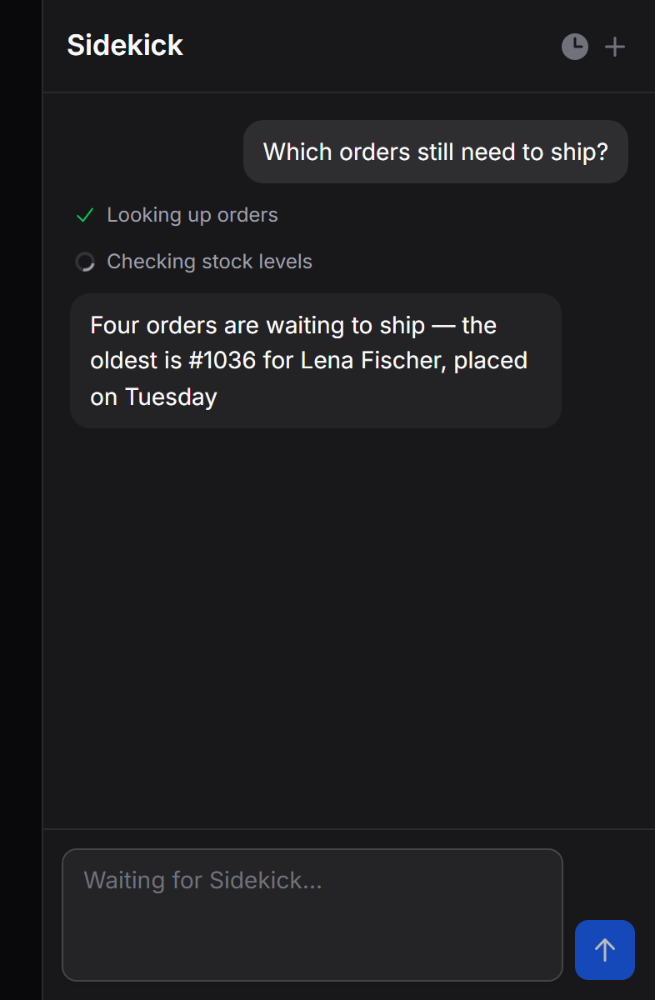</td>
</tr></table>

Polling, only while a turn is active, is the default and needs nothing installed. To push updates over Reverb or Pusher instead, turn on broadcasting; polling stays on as a slower safety net, and a broadcast failure never fails a turn:

```dotenv
SIDEKICK_BROADCASTING=true
```

```php
// config/sidekick.php
'polling' => [
    'interval' => '2s',
    'while_broadcasting' => '10s',
],

'jobs' => [
    'queue' => 'assistant',   // run turns on their own queue
],
```

## Context size and caching

```php
// config/sidekick.php
'history_limit' => 10,            // past messages replayed per turn
'lean_history' => true,           // replay past tool calls with long results stubbed
'history_token_budget' => 2000,   // optional ceiling, in approximate tokens
'history_bytes_per_token' => 4,
'cache_history' => true,          // Anthropic: cache the conversation too
```

`lean_history` keeps past tool calls in view but stubs long results, so the model re-calls tools for fresh data instead of re-reading stale answers. A row cap says nothing about size, so `history_token_budget` bounds it directly: the oldest messages go first, in steps of half the budget so the start of the history stays put and keeps hitting the provider's prompt cache. The newest message is always kept, and the estimate is byte-based, so budget with headroom.

The tool definitions and instructions are always marked for the prompt cache. An agent class of your own must repeat `ChatAgent`'s attributes, since PHP attributes are not inherited:

```php
use Devletes\Sidekick\Agents\ChatAgent;
use Laravel\Ai\Attributes\CacheInstructions;
use Laravel\Ai\Attributes\CacheToolDefinitions;

#[CacheToolDefinitions]
#[CacheInstructions]
class ShopAssistant extends ChatAgent
{
    // …
}
```

```php
// config/sidekick.php
'agent' => \App\Ai\ShopAssistant::class,
```

## Tool catalog

Every authorized tool's definition normally rides along in every request. Past a few dozen, catalog mode offers two tools instead — `ListTools` and `RunTool` — so the prompt stays flat:

```php
// config/sidekick.php
'tool_catalog' => [
    'enabled' => false,
    'above' => 30,
],
```

`above` switches it on once a user's **authorized** set passes that many. Your tools need no changes, `RunTool` re-proves authorization, and a write reached through it still only produces a card. `description()` becomes how the model finds a tool, so make it specific. Below ~15 tools the extra round trip is a loss — scoping with `panels()` and profiles usually helps first.

A tool on the hot path can skip the catalog and always be offered directly:

```php
use Devletes\Sidekick\Contracts\AlwaysOffered;

class SalesSummary extends ChatToolBase implements AlwaysOffered
{
    // …
}
```

## Conversation history

The panel opens on a fresh chat by design. Add a dropdown of recent conversations beside **New conversation** when yours is used daily:

```php
SidekickPlugin::make()->enableHistory()
```

Ownership and profile scope are re-proven on every open, so a tampered id cannot reach another user's chat. To turn it on everywhere, or list more:

```php
// config/sidekick.php
'history' => [
    'enabled' => true,
    'limit' => 20,
],
```

`->enableHistory(false)` then keeps one panel out.

## Panels, tenancy and profiles

`panels()` scopes any tool or action to specific panels; the default `['*']` offers it everywhere:

```php
public function panels(): array
{
    return ['admin'];   // only the admin panel's assistant offers this
}
```

Chat turns run in a worker, where Filament has no idea which panel or tenant the message came from. Sidekick captures the serving panel, tenant and auth guard at dispatch and restores all three, so `Filament::getTenant()` and tenant-scoped queries behave as they do in the panel.

To stamp conversations with your tenant and keep each tenant's history apart, bind a `SidekickContext`:

```php
use Devletes\Sidekick\Support\SidekickContext;
use Filament\Facades\Filament;
use Illuminate\Contracts\Auth\Authenticatable;
use Illuminate\Database\Eloquent\Builder;

class TenantContext implements SidekickContext
{
    public function attributes(Authenticatable $user): array
    {
        return ['channel' => 'web', 'tenant_id' => Filament::getTenant()?->getKey()];
    }

    public function scope(Builder $query, Authenticatable $user): Builder
    {
        return $query->where('tenant_id', Filament::getTenant()?->getKey());
    }
}
```

```php
// AppServiceProvider::register()
$this->app->singleton(SidekickContext::class, TenantContext::class);
```

### Profiles

Different panels can run different assistants off one install. A profile is a named set of top-level config overrides; each key it sets replaces the base value:

```php
// config/sidekick.php
'profiles' => [
    'support' => [
        'assistant' => ['name' => 'Support desk', 'description' => 'Ask about any customer order.'],
        'instructions' => 'You help the support team resolve order problems.',
        'discover' => ['enabled' => false],
        'tools' => [FindOrders::class],
        'actions' => [RefundOrder::class],
    ],
],
```

```php
SidekickPlugin::make()->profile('support')
```

Conversations are stamped with their profile, so each panel keeps its own history, and a queued turn runs under the profile it started in.

## Attachments

Let users attach files in the composer and on confirmation cards:

```php
// config/sidekick.php
'attachments' => [
    'enabled' => true,
    'disk' => 'local',                      // keep it private
    'accept' => ['image/*', 'application/pdf'],
    'max_size' => 12288,                    // KB per file
    'max_files' => 4,
    'prune_after_hours' => 24,
],
```

The model only ever sees metadata — name, type, size and an `attachment_id`. An action asks for files with an `upload` spec on its card, and resolves them on confirm, re-proving ownership:

```php
use Devletes\Sidekick\Models\Attachment;
use Illuminate\Support\Facades\Storage;

public function prepare(array $payload, Authenticatable $user): array
{
    return [
        // payload, summary, preview…
        'upload' => ['required' => true, 'label' => 'Photo of the damage'],
    ];
}

public function execute(array $payload, Authenticatable $user): string
{
    $files = Attachment::query()->forUser($user)->whereIn('id', $payload['attachment_ids'] ?? [])->get();

    foreach ($files as $file) {
        // Uploads are temporary — copy what you keep into your own storage.
        Storage::disk('s3')->writeStream("claims/{$file->name}", Storage::disk($file->disk)->readStream($file->path));
    }

    return 'Claim filed with '.$files->count().' photos.';
}
```

Schedule the cleanup, which deletes every upload older than `prune_after_hours`:

```php
// routes/console.php
Schedule::command('sidekick:prune-attachments')->daily();
```

## Usage limits

The shipped limiter enforces allowances at two levels: the platform caps each tenant, and the tenant divides its cap among its people. It is inert until enabled:

```php
// config/sidekick.php
'limits' => [
    'enabled' => true,
    'tenant' => ['requests_per_day' => 2000, 'tokens_per_month' => 5_000_000],
    'user' => ['requests_per_day' => 50],
],
```

A user allowance is clamped to its tenant's, so it can be stricter but never more generous. Turns the limiter refuses never count against the allowance. To read allowances from your own tables, bind `Contracts\LimitProvider`:

```php
use Devletes\Sidekick\Contracts\LimitProvider;
use Devletes\Sidekick\Support\Limits;
use Illuminate\Contracts\Auth\Authenticatable;

class PlanLimits implements LimitProvider
{
    public function forTenant(int|string|null $tenant): Limits
    {
        return Limits::fromArray(Plan::for($tenant)->limits);
    }

    public function forUser(Authenticatable $user, int|string|null $tenant): Limits
    {
        return Limits::fromArray($user->assistant_limits);
    }
}
```

```php
// config/sidekick.php
'limits' => [
    'enabled' => true,
    'provider' => \App\Sidekick\PlanLimits::class,
],
```

For anything the two levels cannot express, replace the limiter outright. `check()` returns `null` to allow, or a message to deny — shown to the user verbatim. It runs before a turn is queued and again in the worker, before any tokens are spent:

```php
use Devletes\Sidekick\Contracts\UsageLimiter;

class TrialLimiter implements UsageLimiter
{
    public function check(Authenticatable $user, ?string $conversationId): ?string
    {
        return $user->trialExpired() ? 'Your trial has ended — upgrade to keep using the assistant.' : null;
    }
}
```

```php
// config/sidekick.php
'usage_limiter' => \App\Sidekick\TrialLimiter::class,
```

To give some turns away — your own onboarding, say — mark them exempt. They are never refused and never counted, but are still logged with their tokens:

```php
use Devletes\Sidekick\Contracts\UsageExemptions;

class OnboardingIsFree implements UsageExemptions
{
    public function exempt(Authenticatable $user, int|string|null $tenant): bool
    {
        return Onboarding::inProgressFor($user, $tenant);
    }
}
```

```php
// config/sidekick.php
'limits' => [
    'exemptions' => \App\Sidekick\OnboardingIsFree::class,
],
```

## Insights

An operator page — turns, tokens, failure rate, a 30-day chart and recent activity — off until a panel asks for it:

```php
SidekickPlugin::make()->enableInsights(fn ($user) => $user->is_admin)
```

<table><tr>
<td width="50%">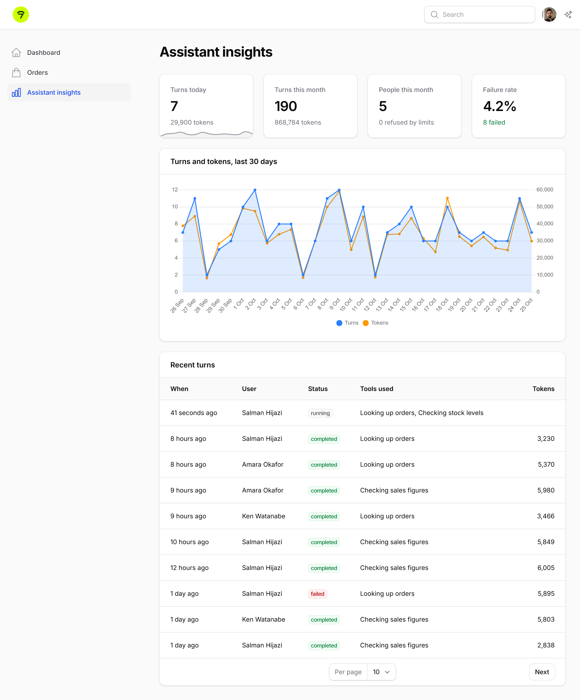</td>
<td width="50%">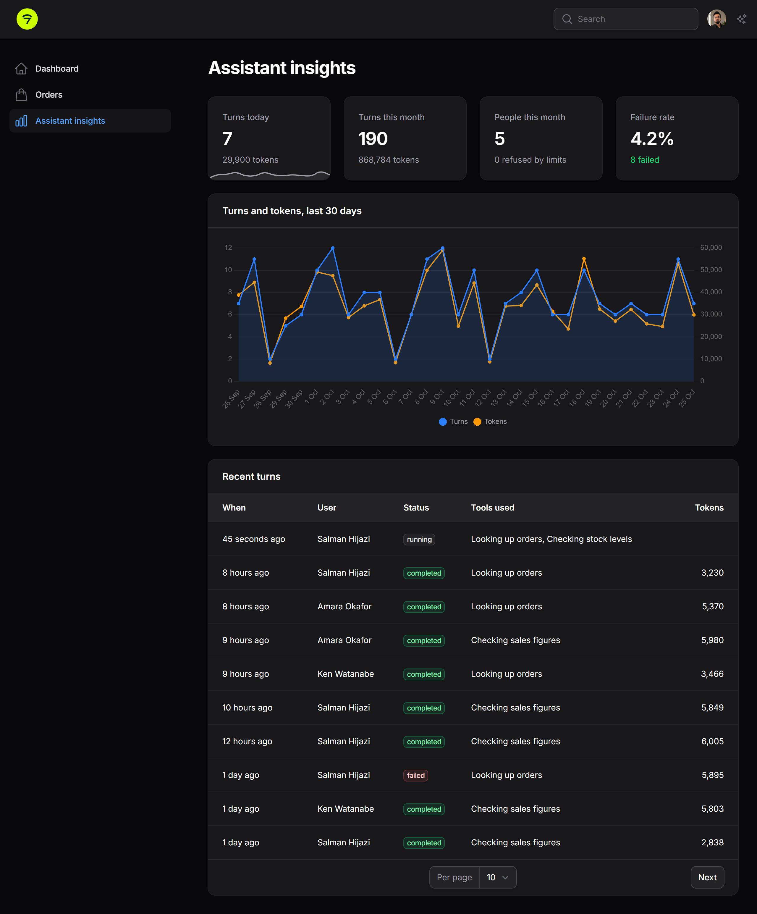</td>
</tr></table>

Pass a closure to say who may open it; the page totals other people's usage. It is tenant-scoped and fails closed: with tenancy on but no tenant resolved, it shows nothing.

For an admin console that wants the numbers without an assistant:

```php
SidekickPlugin::make()
    ->enableInsights(fn ($user) => $user->isPlatformAdmin())
    ->withoutChat()
```

On a panel that spans tenants, the page adds a usage-by-tenant table. Tenants and users show by name with no configuration; correct the guess only when it is wrong:

```php
// config/sidekick.php
'insights' => [
    'show_prompts' => false,                      // prompts are people's own words
    'tenant_model' => \App\Models\Store::class,   // usually discovered from your panels
    'tenant_label_attribute' => 'name',
    'user_label_attribute' => 'full_name',
],
```

The page is customised by extending it:

```php
use Devletes\Sidekick\Pages\SidekickInsights;

class AssistantInsights extends SidekickInsights
{
    protected static ?string $navigationLabel = 'Assistant usage';

    protected static string | UnitEnum | null $navigationGroup = 'Reports';
}
```

```php
SidekickPlugin::make()
    ->enableInsights(fn ($user) => $user->is_admin)
    ->insightsPage(AssistantInsights::class)
```

The widgets are ordinary Filament tables too. `RecentRuns::userColumn()`, `RecentRuns::tenantColumn()` and `TenantUsage::tenantColumn()` are the seams for rendering a person or tenant your own way; list the subclass from your page:

```php
use App\Models\User;
use Devletes\Sidekick\Widgets\RecentRuns;
use Filament\Tables\Columns\Column;
use Filament\Tables\Columns\TextColumn;

class RecentAssistantRuns extends RecentRuns
{
    protected function userColumn(): Column
    {
        return TextColumn::make('user_id')
            ->label('Who')
            ->formatStateUsing(fn ($state) => User::find($state)?->email ?? $state);
    }
}
```

```php
// In AssistantInsights
protected function getHeaderWidgets(): array
{
    return [UsageOverview::class, TurnsChart::class, TenantUsage::class, RecentAssistantRuns::class];
}
```

## Translations

Every user-facing string goes through `sidekick::messages.*`. English ships with the package; publish it to translate or reword:

```bash
php artisan vendor:publish --tag=sidekick-translations
```

Missing keys fall back to the packaged English, so a partial translation is safe. The assistant's replies follow the language the user writes in.

## Theming

The panel follows your Filament theme with no configuration. Everything else is a CSS custom property — declare any `--sidekick-*` on `body` in your theme stylesheet:

```css
body {
    --sidekick-width: 26rem;
    --sidekick-bubble-user-bg: #e0e7ff;
    --sidekick-bubble-radius: 1.25rem;
}
```

| Variable | Notes |
|---|---|
| `--sidekick-width` / `--sidekick-top` / `--sidekick-height` | Panel geometry. Width is also settable via `sidekick.panel.width` |
| `--sidekick-edge-offset` | How far the aside climbs the layout's vertical padding in full-height mode |
| `--sidekick-bg` / `--sidekick-border` / `--sidekick-text` / `--sidekick-muted` | Panel surfaces |
| `--sidekick-bubble-user-bg` / `--sidekick-bubble-assistant-bg` / `--sidekick-bubble-radius` | Message bubbles |
| `--sidekick-composer-field-min` / `--sidekick-composer-btn-px` / `--sidekick-composer-btn-min` | Composer textarea and icon buttons |

Panel state is mirrored onto `<body>` as `sidekick-open`, `sidekick-full-height` and `sidekick-ready`, so you can move your own chrome out of the way:

```css
body.sidekick-open .my-floating-button { right: calc(var(--sidekick-width) + 1rem); }
```

<table><tr>
<td width="50%">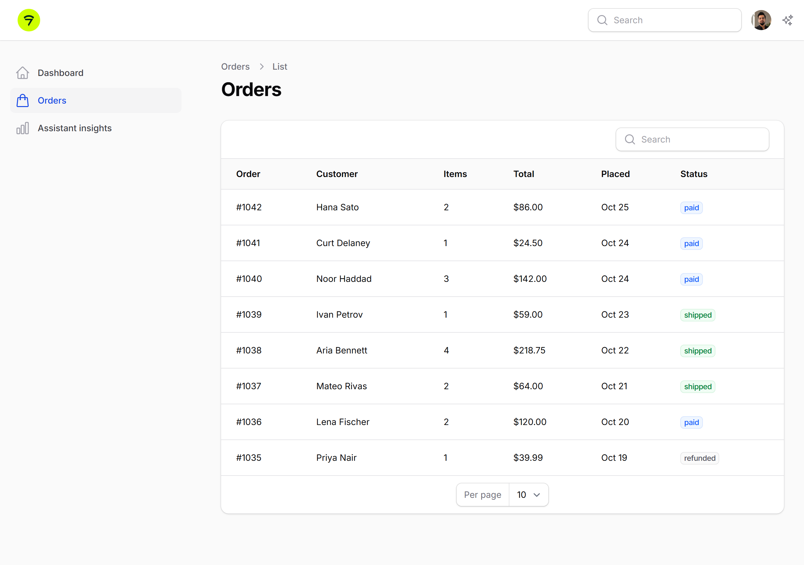</td>
<td width="50%">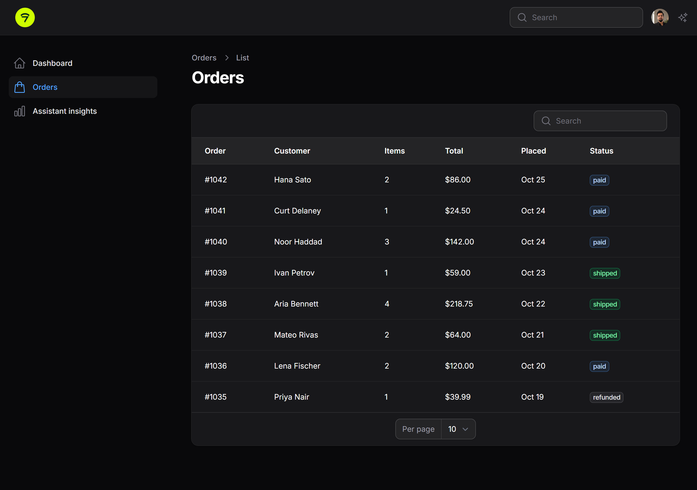</td>
</tr></table>

Every icon is configurable, and the panel can run edge-to-edge instead of below the topbar:

```php
// config/sidekick.php
'icons' => [
    'assistant' => 'heroicon-o-chat-bubble-left-right',
    'send' => 'heroicon-m-paper-airplane',
],

'panel' => [
    'width' => '26rem',
    'full_height' => true,
],
```

The toggle can also be set per panel — an icon name, or raw SVG for a custom logo:

```php
SidekickPlugin::make()->icon('heroicon-o-chat-bubble-left-right')
SidekickPlugin::make()->icon(view('icons.my-logo'))
```

## API reference

### Plugin

| Method | Notes |
|---|---|
| `enableHistory(bool $condition = true)` | Recent-conversations dropdown |
| `enableInsights(bool\|Closure $condition = true)` | The insights page; a closure decides who may open it |
| `insightsPage(?string $page)` | Register your `SidekickInsights` subclass instead |
| `withoutChat()` | Everything except the chat panel, for an insights-only console |
| `profile(?string $profile)` | Run this panel's assistant under a `sidekick.profiles` entry |
| `icon(string\|Htmlable\|Closure\|null $icon)` | Toggle icon: a name or raw SVG |

### Commands

| Command | Notes |
|---|---|
| `sidekick:install` | Publish config, offer to migrate. `--migrate` skips the prompt |
| `sidekick:tool {name}` | A read tool in `app/Sidekick` |
| `sidekick:action {name}` | A confirmable action in `app/Sidekick` |
| `sidekick:scaffold` | A search tool per resource plus a resolver. `--actions`, `--dry-run` |
| `sidekick:check` | Tools and actions with missing dependencies; non-zero exit. `--uses=` lists dependents |
| `sidekick:prune-attachments` | Delete uploads older than `prune_after_hours`. Schedule daily |

### Extension points

| Seam | Purpose |
|---|---|
| `Contracts\ActionResolver` | Named navigation targets → authorized URLs |
| `Contracts\ProvidesTurnContext` | Per-turn context on the user's message, keeping instructions cacheable |
| `Contracts\AlwaysOffered` | Keep a tool out of the catalog and directly in the prompt |
| `Contracts\LimitProvider` | Where allowances come from — a tenant's plan, a user's settings |
| `Contracts\UsageLimiter` | Replace the shipped limiter outright |
| `Contracts\UsageExemptions` | Turns that are free: logged, never refused, never counted |
| `Support\SidekickContext` | Stamp extra columns onto conversations and scope conversation queries |
| `sidekick.agent` / `sidekick.jobs.run` | Subclass `ChatAgent` or `RunChatTurn` for app concerns |

## Testing

```bash
composer install
composer test
```

The suite runs on Testbench with the real Filament and laravel/ai stack, against SQLite. CI covers PHP 8.3 and 8.4 on Laravel 12 and 13.

## Need something custom?

We build production Filament panels and plugins for teams that want to ship fast without compromising on polish. If you need a custom feature, an extended variant of this package, or a fully bespoke component built for your stack, we can help.

- **Browse the rest of our Filament work:** [filament.devletes.com](https://filament.devletes.com)
- **Get in touch:** [salman@devletes.com](mailto:salman@devletes.com)

Typical engagements: new Filament plugins, custom resources/widgets/actions, theme + UX work, integrations with your existing services, and one-off tailored forks of our open-source packages.

## Have you seen our Orbit theme?

Orbit is our dark-first theme for Filament 5. Every panel surface is restyled — sidebar, topbar, forms, tables, modals, notifications.

<table><tr>
<td width="50%"></td>
<td width="50%"></td>
</tr></table>

**[Check it out here](https://filament.devletes.com/orbit) →**

## Credits

- [Salman Hijazi](https://www.linkedin.com/in/syedsalmanhijazi/)

## License

MIT. See [LICENSE.md](LICENSE.md).
